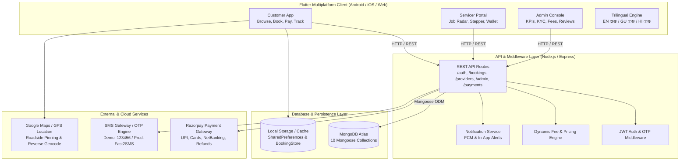
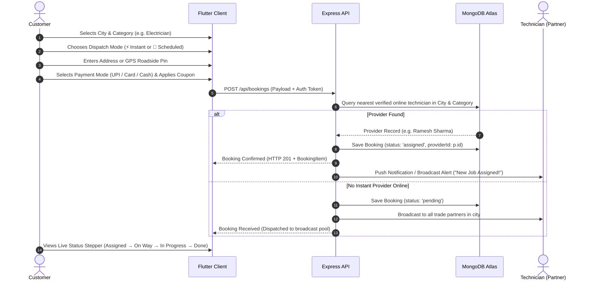
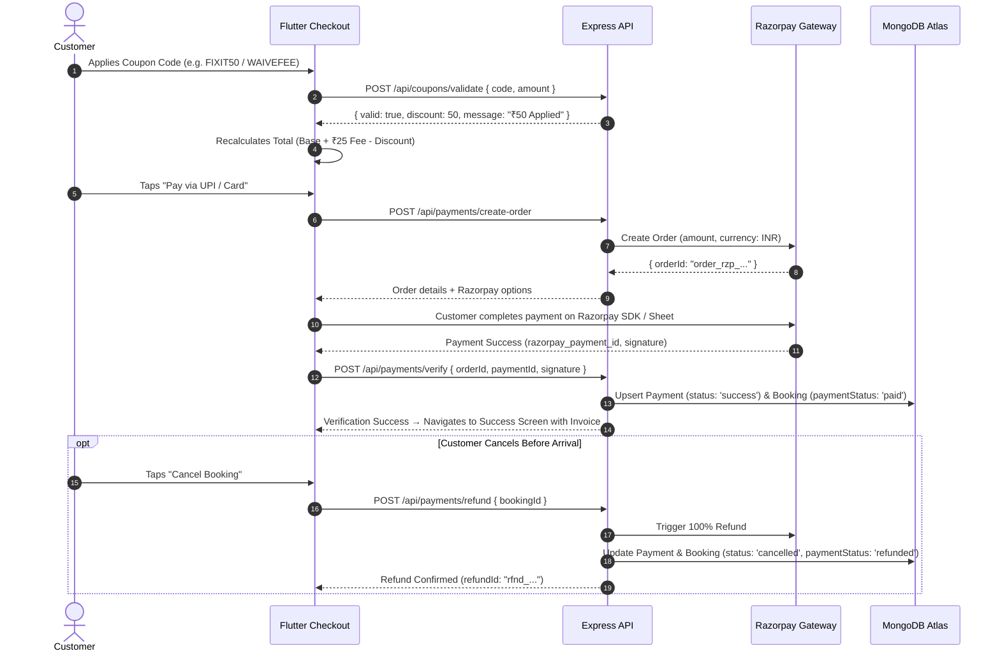
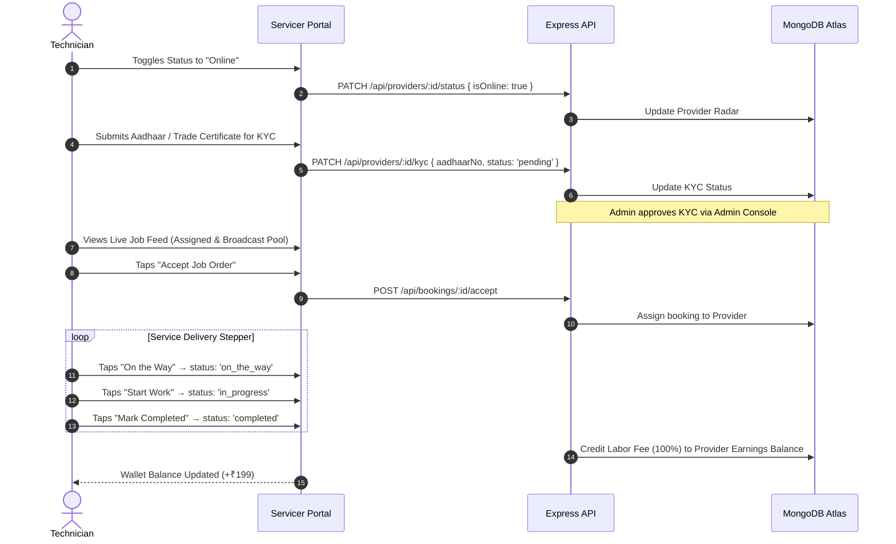
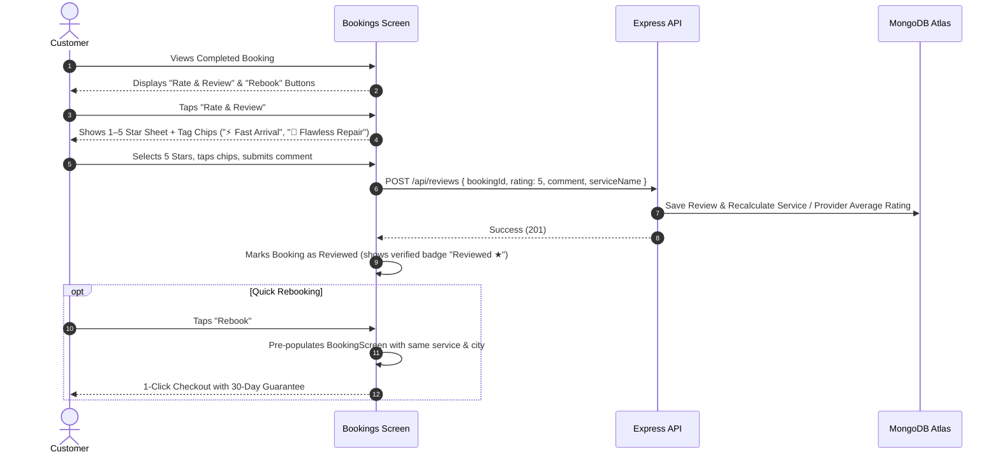

# FixIt – System Design, Architecture & Operational Workflow
**A Hyper-Local On-Demand Home Services & Roadside Assistance Marketplace**

---

## 1. Executive Summary & Core Value Proposition

**FixIt** is an on-demand marketplace connecting urban consumers with verified local home repair tradespeople and roadside emergency mechanics across 12 operational cities in Gujarat (and expanding nationwide).

### The FixIt Economic Model
Unlike traditional aggregator platforms that take 20%–35% commissions from tradespeople, FixIt operates on an **Operator-First Transparency Model**:
- **Labor Protection:** Service providers retain **100% of their base service charge quote**.
- **Platform Revenue:** FixIt charges a flat, dynamic **₹25 booking fee** per confirmed booking.
- **Consumer Pricing Formula:**
  $$\text{Total Payable} = \text{Service Quote (100\% to Pro)} + \text{Dynamic Platform Fee (₹25)} - \text{Promotional Discounts}$$

### Dual Fulfillment Modes
1. **⚡ Instant Quick-Commerce Dispatch (15–30 Mins):** For urgent emergencies (vehicle roadside breakdown, flat tyre, jump-start, gas leak, pipe burst, lockout). Uses broadcast radar dispatch to the nearest online verified technician.
2. **📅 Flexible Multi-Slot Scheduling:** Calendar date selection up to 60 days ahead with exact-minute picker, 2-hour standard slots, or half-day flexible windows.

---

## 2. High-Level System Architecture



---

## 3. End-to-End Operational Workflows

### 3.1 Customer Booking & Dispatch Workflow



### 3.2 Payment, Coupon & Refund Pipeline



### 3.3 Technician Operating Lifecycle & KYC



### 3.4 Ratings, Reviews & Rebooking Loop



---

## 4. Multi-Tenant Role Architecture

FixIt provides three unified operational portals in a single multi-role codebase:

```
┌─────────────────────────────────────────────────────────────────────────┐
│                           FIXIT APPLICATION                             │
├──────────────────────────┬───────────────────────┬──────────────────────┤
│ 🛒 Customer Experience   │ 🔧 Servicer Portal    │ 🏢 Admin Console     │
│ • City & Trade Selector  │ • Online / Offline    │ • Live Analytics GMV │
│ • Instant / Scheduled    │ • Live Job Radar      │ • KYC Verification   │
│ • Razorpay / Cash        │ • 4-Stage Stepper     │ • Fee Configurator   │
│ • Order Stepper Tracking │ • Aadhaar KYC         │ • Catalog Modifier   │
│ • Star Ratings & Reviews │ • Instant Bank Payout │ • Reviews Moderation │
│ • 1-Click Rebooking      │ • Emergency Hotline   │ • City Network Add   │
└──────────────────────────┴───────────────────────┴──────────────────────┘
```

---

## 5. MongoDB Database Schemas (10 Collections)

| Collection | Key Fields | Primary Purpose |
| :--- | :--- | :--- |
| **`users`** | `phone` (unique), `name`, `role`, `city`, `savedAddresses[]` | Customer & admin credentials, address book |
| **`cities`** | `name` (unique), `state`, `isActive` | Multi-city operational network management |
| **`categories`**| `id` (slug), `name`, `iconName`, `colorHex`, `isActive` | 19 Service trades (Home + Emergency RSA) |
| **`services`** | `id`, `categoryId`, `cityId`, `name`, `price`, `included[]` | 85+ Standardized service offerings |
| **`providers`** | `name`, `phone`, `categoryId`, `city`, `kycStatus`, `isOnline`, `rating`, `completedJobs`, `totalEarnings` | Technician profiles, availability, and earnings |
| **`bookings`** | `bookingId`, `customerPhone`, `providerId`, `serviceName`, `price`, `platformFee`, `status`, `paymentStatus`, `coordinates` | Full order lifecycle and assignment state |
| **`payments`** | `orderId`, `bookingId`, `totalAmount`, `platformFee`, `providerPayout`, `method`, `status`, `refundId` | Financial ledger and Razorpay transaction records |
| **`reviews`** | `bookingId`, `rating` (1–5), `comment`, `userName`, `serviceName` | Customer satisfaction feedback |
| **`settings`** | `key` (e.g. `platformFee`), `value` (e.g. `25`), `description` | Dynamic platform policies without redeploying code |
| **`notifications`**| `recipientPhone`, `title`, `message`, `type`, `bookingId`, `isRead` | Dispatch alerts and transactional updates |

---

## 6. How the System is Currently Performing

### Current Strengths
1. **Resilience & Zero-Crash Architecture:**
   - Both backend and frontend include automatic fallbacks. If MongoDB Atlas has latency or runs offline in test environments, the system responds immediately with cached seed datasets.
   - 31 / 31 backend unit tests passing (100%).
   - Flutter static analysis has 0 issues, and all widget/workflow tests pass.
2. **True State Synchronization:**
   - Client uses a centralized singleton `BookingStore` and `AppServicesProvider`. Any status advance from the Servicer app or Admin panel propagates immediately to the UI without requiring an app reload.
3. **Comprehensive Scope:**
   - 19 distinct trade categories covering household maintenance, plumbing, electrical, civil, and 24x7 Emergency Roadside Breakdown assistance.
   - Trilingual localization in English, Gujarati, and Hindi.

---

## 7. Deep Gap Analysis: Current State vs. Production Enterprise Standards

| Architectural Area | Current Implementation | Production Enterprise Target | Priority |
| :--- | :--- | :--- | :--- |
| **Provider Dispatch & Geofencing** | Matches technician by City string (e.g. `"Rajkot"`) and trade category. | **Geospatial Indexing (`2dsphere`) & Geohashing:** Find technicians within a 5 km Haversine radius of customer GPS coordinates. | **High** |
| **Real-Time Communication** | HTTP REST polling and local state synchronization. | **WebSockets / Socket.io:** Real-time bi-directional channel for live Uber-style moving map vehicle tracking and in-app chat. | **High** |
| **Payment Gateway Integration** | Simulated Razorpay order creation, verification, and refund pipeline with test-resilient fallbacks. | **Live Razorpay SDK + Webhooks:** Plug in live Razorpay Key ID/Secret; verify webhook signatures for asynchronous payment and refund confirmation. | **High** |
| **Automated Payouts** | Manual payout simulation that increments `totalEarnings`. | **Razorpay Route (Marketplace Splits):** Automatically routes ₹25 to FixIt bank account and transfers the service labor directly to technician's UPI/bank account upon completion. | **Medium** |
| **Authentication & OTP** | Simulated OTP (`123456`) with JWT token issuance. | **Live SMS Provider:** Fast2SMS, MSG91, or Firebase Phone Auth for real 6-digit SMS OTP delivery. | **Medium** |
| **Push Notifications** | In-app notification feed + mock FCM handler. | **Firebase Cloud Messaging (FCM):** Background push notifications waking device when a technician receives a job or customer receives an arrival update. | **Medium** |
| **Cloud Hosting & CDN** | Local execution on port `5000` / Android emulator `10.0.2.2`. | **Production Cloud:** Deploy backend to AWS ECS / Render / Railway with managed MongoDB Atlas cluster and Cloudflare SSL/CDN. | **High** |

---

## 8. Strategic Roadmap & Next Steps (Phase 7 & Beyond)

### Phase 7: Live Cloud Deployment, Razorpay Wiring & Production Hardening

```
┌─────────────────────────────────────────────────────────────────────────────┐
│                          PHASE 7 EXECUTION MATRIX                           │
├─────────────────────────────────────────────────────────────────────────────┤
│ 1. Production Cloud Backend Deployment                                      │
│    • Deploy Express backend on Render / Railway / AWS.                      │
│    • Set production environment variables (MONGO_URI, JWT_SECRET, RZP_KEY). │
│    • Configure automated health checks and log streaming.                  │
│                                                                             │
│ 2. Live Razorpay Payment Gateway & Webhooks                                 │
│    • Add live Razorpay Merchant credentials.                                │
│    • Implement `POST /api/payments/razorpay-webhook` for async captures.    │
│    • Verify signatures via HMAC SHA256.                                     │
│                                                                             │
│ 3. Real-Time Tracking & Socket.io Engine                                    │
│    • Integrate Socket.io on Express server.                                 │
│    • Stream technician GPS coordinates every 5 seconds during `on_the_way`. │
│    • Render live moving marker on Flutter Google Maps widget.               │
│                                                                             │
│ 4. Production SMS & Firebase Push Notifications                             │
│    • Wire Firebase Admin SDK (`serviceAccountKey.json`).                    │
│    • Send background notifications on booking updates.                      │
│    • Connect Fast2SMS / Twilio for customer phone verification.             │
│                                                                             │
│ 5. App Store & Play Store Release Pipeline                                  │
│    • Configure Android Keystore & Gradle release signing.                   │
│    • Build optimized production bundles (`flutter build appbundle`).        │
│    • Conduct closed beta testing in Rajkot & Ahmedabad hubs.                │
└─────────────────────────────────────────────────────────────────────────────┘
```

---

## 9. Quick-Start Guide for Running the Full Stack

### 1. Launching the Backend Server
```bash
cd backend
npm install
npm run seed      # Seeds 12 cities, 19 categories, 85+ services, reviews & providers
npm run dev       # Starts server on http://localhost:5000 (hot reload with nodemon)
npm test          # Runs 31 unit & API tests (100% pass)
```

### 2. Launching the Flutter Client
```bash
cd fixit
flutter pub get
flutter analyze   # 0 warnings / No issues found
flutter test      # Runs all widget & business logic tests
flutter run       # Launches on Chrome, Android Emulator, or connected device
```
